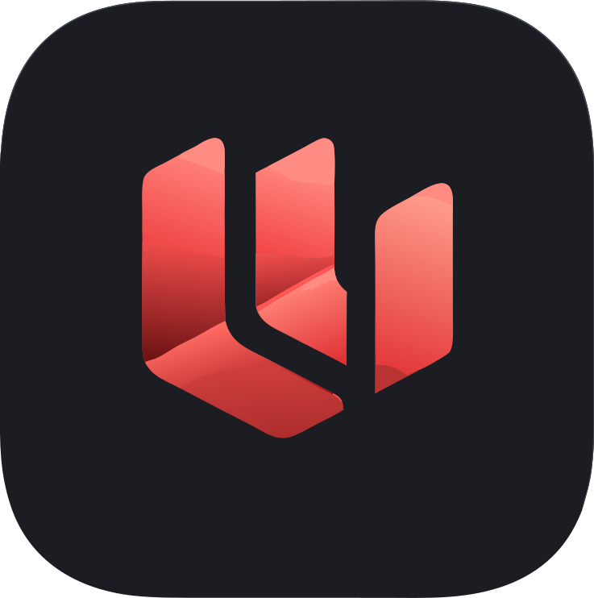
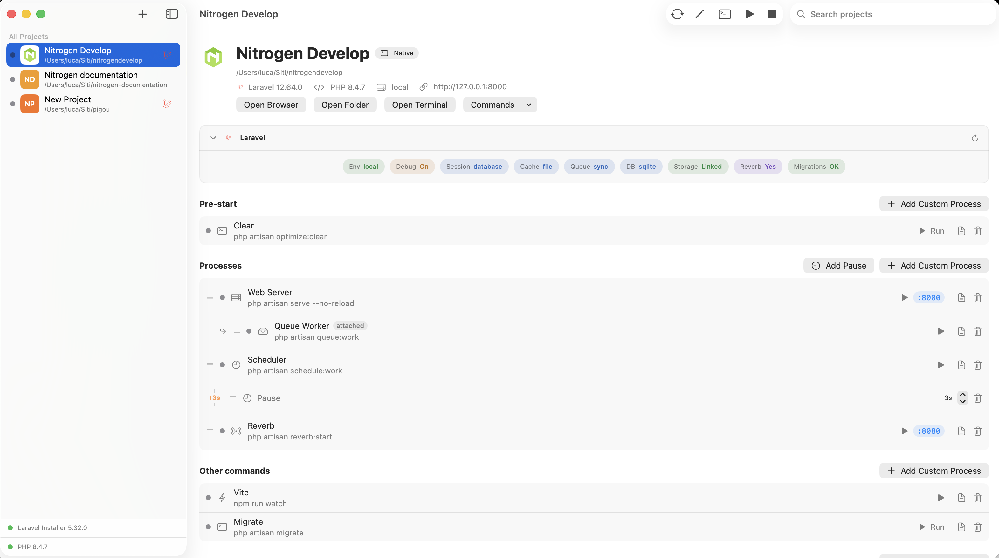
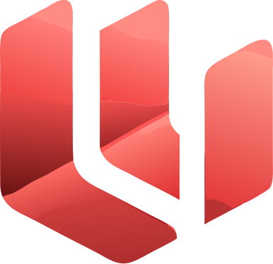

<p align="center">
  
</p>

<h1 align="center">Laradeck</h1>

<p align="center">
  <strong>Stop juggling terminals. Start shipping.</strong><br />
  A native macOS control panel for Laravel — processes, Docker Compose, logs and artisan tasks in one place.
</p>

<p align="center">
  <a href="https://github.com/brokenicedev/laradeck"></a>
  <a href="https://github.com/brokenicedev/laradeck"></a>
  <a href="https://laravel.com"></a>
  <a href="LICENSE"></a>
  
</p>

<p align="center">
  <a href="https://laradeck.brokenice.it"><strong>Releases</strong></a>
  ·
  <a href="https://github.com/brokenicedev/laradeck/issues"><strong>Issues &amp; feedback</strong></a>
  ·
  <a href="https://brokenice.it"><strong>brokenice.it</strong></a>
</p>

---

## Join the beta

<p align="center">
  <a href="https://laradeck.brokenice.it">
    
  </a>
</p>

Requires **macOS 14+** (Apple silicon & Intel), local Laravel projects, and **Docker Desktop** if you use Sail or Compose features.

Found a bug? [Open an issue](https://github.com/brokenicedev/laradeck/issues) — screenshots and macOS version help a lot.

---

## What Laradeck does

<p align="center">
  
</p>

One native Mac app to run and monitor every Laravel project on your machine:

| | |
|---|---|
| **Projects** | Scan folders or drag & drop — Native PHP, Sail, or plain Docker Compose |
| **Processes** | Server, queue, scheduler, Horizon, Reverb, Vite, npm/composer scripts |
| **Start All** | Visual startup sequences — order, pauses, nested dependencies |
| **Docker** | Compose up/down, live build output, container logs and shell |
| **Laravel** | Insights, artisan shortcuts, env/migration/storage checks |
| **Menu bar** | Start/stop and open in browser without raising the main window |
| **Logs** | Integrated terminal viewer per process, `laravel.log`, compose output |

Built with **SwiftUI**. Free. Made by [**brokenice.it**](https://brokenice.it).

---

## Roadmap

```
Now          Open source, beta releases, feedback
     ↓
Next         Community contributions
     ↓
Later        Stable 1.0
```

---

## Stay in the loop

- **Star** this repository for release notifications  
- **Watch** → Custom → Releases  
- Report issues on [GitHub Issues](https://github.com/brokenicedev/laradeck/issues)  
- Contact: [hello@brokenice.it](mailto:hello@brokenice.it)

---

<p align="center">
  
  <br />
  <sub>Laradeck — made with care for Laravel developers on macOS</sub>
</p>
